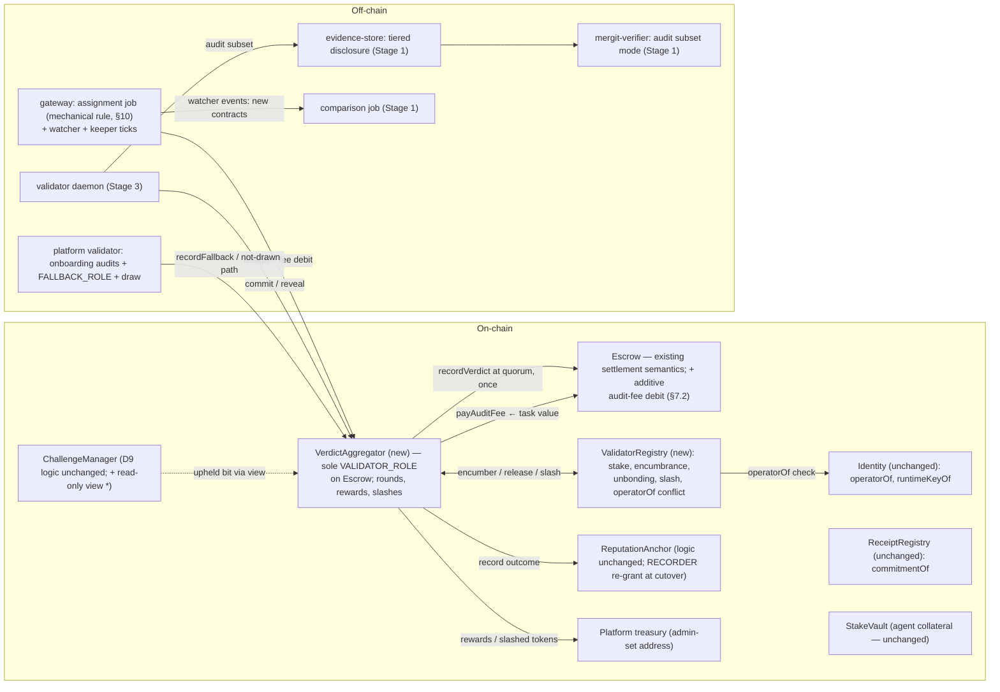

# P5 — Permissionless staked validation (v0): technical design

**Version:** 2.0
**Date:** 2026-11-03
**Issue:** [mergit-io/mergit#36](https://github.com/mergit-io/mergit/issues) — *P5: permissionless staked validation (open the audit role to bonded validators)*
**Status:** Final design specification. Issue #36 is **not yet implemented**; every component, state machine, parameter set and behaviour described in §4–§16 is proposed v0 functionality unless explicitly marked as existing behaviour in §3.

**Design sources:**

- The Mergit research paper ([`mergit-research`](https://github.com/mergit-io/mergit-research), `paper/draft-v1.md`, draft v1 rev 5) — the design source of truth.
- Issue #36 — the acceptance checklist for v0.
- [`docs/PRD.md`](../../PRD.md) — §4, §5, §7, §8, §9, §11, §12, §14 (P5), §15.
- [`docs/HLD.md`](../../HLD.md) — C16, D9, D15, I7, I12, K2 (validator key).
- [`CLAUDE.md`](../../../CLAUDE.md) — invariants 1–7.
- The existing implementation in this repository (`chain/`, `evidence/`, `verifier/`, `spec/`, `control-plane/`).

> **Precedence.** Where this document and the paper disagree, the paper is right and this document
> is a defect: fix this document; never reconcile the conflict by editing the paper — conflicts are
> raised on `mergit-research`. Where this document and the issue disagree, the issue's stated
> requirements govern.

---

## 1. Scope and background

Today the platform's routine audit path runs under a single `VALIDATOR_ROLE`-gated key that both
decides whether an audit is drawn and records every verdict (§3). Challenge is already
permissionless and bonded; routine audit is not. This document specifies v0 of **permissionless
staked validation**: bonded validators outside the platform register, stake, are assigned to audits
of committed receipts under a fixed non-discretionary rule, submit verdicts through a commit-then-
reveal round, and are paid and slashed by contract rules. The platform validator remains in the
system as the fallback so that a task never hangs.

The design follows the simplest implementable path that satisfies the issue:

- Two new contracts (`ValidatorRegistry`, `VerdictAggregator`) plus one additive entry point on
  `Escrow` and one read-only view on `ChallengeManager`.
- Validator rewards are funded directly from an audit fee carved from the task payment at
  assignment — the mechanism the issue's Stage 2 states. There is no platform subsidy pool in
  the reward path and no requester-paid pricing change.
- All record-keeping is single-phase, directly applied accounting: rewards transferred at
  aggregation, slashes applied to stake. There is no reward ledger, no deferred settlement fork,
  and no compensation machinery in v0.

The audit role becomes independent; the claim this product can make today, given that receipts are
unattested, is *independent audit of commitment consistency and the Φ evidence* — not trustless
verification of execution (IR-5, paper §1.8, §12.5). This boundary is normative for all docs and UI.

## 2. Requirements and design sources

### 2.1 Requirements stated by issue #36 (binding for v0)

| ID | Issue-stated requirement |
|---|---|
| IR-1 | Anyone can stake, become a validator, audit assigned tasks and be paid, without the platform's permission. |
| IR-2 | No single validator's verdict settles money alone. |
| IR-3 | Lazy, copying and conflicted validators lose money; tests assert the guards fire. |
| IR-4 | The platform validator remains as the fallback so a task never hangs. |
| IR-5 | The limitation to state plainly: receipts are unattested; opening the audit role makes the audit independent of the platform, not execution verifiable. Docs and UI must not say more. |
| IR-6 | Not permissionless adjudication (D9): `ChallengeManager.resolve` stays with the platform for now. |
| IR-7 | Not attestation (P1), reputation or routing (P4), or k-of-n redundant execution; no token (PRD §8). |
| IR-8 | Onboarding (faucet) tier stays platform-audited at platform expense; outside validators do not touch it initially (free credits mean zero effective stake, so slashing a faucet-task auditor is meaningless). |
| IR-9 | No number is presented as measured until it has been; all parameters are labelled parameters, not results. |
| IR-10 | Stage 1 of the issue's plan: a documented, standalone, read-only audit tool anyone can run against the chain and store; published audit records; a comparison job that flags any outside verdict differing from the platform's; tiered disclosure in `evidence/store` (audit-level subset with Merkle paths; the full trajectory only under bond); agreement/disagreement data labelled as measured only once it is. |
| IR-11 | Stage 2 of the issue's plan, in `mergit-contracts`: `ValidatorRegistry` (stake deposit, unbonding delay, no auditing a task whose agent it operates); a verdict aggregator holding `VALIDATOR_ROLE` instead of an EOA; each drawn audit assigned to `n` validators; commit-then-reveal; at quorum, stake-weighted plurality with outlier clipping (paper §14), then one `recordVerdict`; platform fallback on quorum timeout; slashing where no-reveal and consensus deviation cost stake and a verdict overturned by a successful challenge costs more; **rewards come from the audit fee**; `markNotDrawn` and the draw decision are not a validator-controlled escape hatch (platform draws until a sortition design is agreed); gateway watcher/keeper integration (new events, assignment, timeouts). |
| IR-12 | Stage 3 of the issue's plan: a validator CLI/daemon (stake, watch assignments, audit, commit, reveal, claim) and a testnet runbook exercising a lazy "always pass" validator, a conflicted validator and a correct minority, each handled as designed, with recorded tx hashes. |
| IR-13 | Sequencing: run both e2e runbooks and add Rust CI first ("building a validator network on settlement flows never recorded end to end is shaky"); each stage ships on its own and leaves the system working. |
| IT-1 | A validator cannot audit its own agent's task. |
| IT-2 | A reveal that does not match its commit is rejected; double votes are rejected. |
| IT-3 | A lazy "always pass" validator is slashed after a successful challenge. |
| IT-4 | A correct minority: behaviour pinned down and documented. |
| IT-5 | Unstaking mid-audit is blocked. |
| IT-6 | Quorum timeout falls back to the platform validator. |
| IT-7 | Onboarding-tier tasks never route to outside validators. |
| ID-1..6 | The issue's six decisions gating spec sign-off — all resolved and recorded in §2.3. |

### 2.2 Research-paper constraints and ambiguities

| ID | Paper-derived constraint or ambiguity |
|---|---|
| PR-1 | Aggregation uses **stake-weighted plurality with outlier clipping**, "after [8]" (Bittensor's Yuma mechanism). The paper specifies the mechanism *family* only: it names no reference statistic, no clipping formula, no validator-set size, no quorum and no parameters. Whatever v0 implements must be presented as an adaptation requiring upstream clarification, not a paper-prescribed formula. |
| PR-2 | Consensus-penalizing aggregation *"discourages a correct minority as well as an incorrect one"*. The trade-off must be stated and actively managed, not designed away. |
| PR-3 | A wrong validator majority is corrected **only through the challenger population**; `q > 0` is an assumption about motivated parties existing, not a property the protocol enforces. |
| PR-4 | Audit cost is bounded by **disclosed evidence volume**, not trajectory length (paper §7.1, §6.3). |
| PR-5 | The platform is a party, not a neutral oracle. P5 removes the centralization of the *audit* role; it does not make the system trustless (paper §5.4, §13). |
| PR-6 | Griefing is bounded (challenge bonds, per-task exposure), not solved (paper §12.8). |
| PR-7 | The paper contains no validator-side collusion/deterrence model (its §7 repeated-game analysis is agent-side). Bond and slash magnitudes therefore require a hand-derived deterrence analysis as evidence before they are chosen. |

### 2.3 Proposed v0 implementation choices

These are choices made in this document, not requirements stated by the issue or the paper. Each
exists to satisfy an issue requirement or an identified security invariant with the least machinery.

| # | Choice | Rationale |
|---|---|---|
| P-1 | The audit fee is carved from the task's payment at assignment; no requester-paid pricing change and no platform subsidy | follows IR-11's "rewards come from the audit fee"; the round is self-funded by construction (§7) |
| P-2 | Clipping cap = `clipMultiple × minStake` (composition-independent, anchored to a required parameter) | implements IR-11/PR-1's clipping without a participant-set statistic; a *proposed v0 policy* requiring justification, testing and upstream clarification — not a paper-prescribed formula (§6.5) |
| P-3 | Vote weight uses each validator's stake as recorded at assignment | deterministic and race-free against mid-round stake changes (§6.5) |
| P-4 | The reveal window opens at the commit deadline; no commit-count gate | one simple rule; lazy-copy protection comes from the commit binding itself (§6.3) |
| P-5 | Rewards are paid once, at aggregation, only to revealers whose verdict matches the recorded aggregate; timed-out rounds reward nobody | issue-minimal accounting; the issue names reward only for correct audits (§8.1) |
| P-6 | Slash events apply directly to stake, bounded per task; slashed tokens are transferred to a platform treasury | no reward ledger and no re-routing economy are required by the issue (§8.2–§8.3) |
| P-7 | An overturn's additional penalty applies to backers' **stake**; rewards already credited stay credited | the issue's overturn penalty speaks in terms of cost to the validator; reward clawback would reintroduce the removed accounting machinery (§8.4) |
| P-8 | Assignment follows a fixed, deterministic, published rule executed by the gateway | IR-1 without per-validator discretion; selection provenance is off-chain (§10) |
| P-9 | Assignment admits fewer than `n` validators when the eligible set is smaller; when none are eligible the drawn task goes to the platform fallback path | cold-start liveness without redeployment semantics (§10) |
| P-10 | An exact weight tie records `fail` | a split audit never releases worker payment or slashes the agent by a coin flip (§6.6) |
| P-11 | Declining is implicit: silence carries no penalty | the issue's only no-show penalty is committed-not-revealed (§8.2) |
| P-12 | The aggregator is the sole `VALIDATOR_ROLE` holder on `Escrow` and the single on-chain writer of consensus-verdict accounting; the platform validator writes only through a narrow `FALLBACK_ROLE` surface | IR-2 with one verdict writer; fallback scope is bounded (§12) |

### 2.4 Resolution of the issue's six decisions

1. **Who pays validators (Q4):** the audit fee, carved from task value at assignment (P-1). Escrow
   gains one additive entry point; worker payout is reduced by the fee; see §7.
2. **Aggregation:** stake-weighted plurality with outlier clipping, under the proposed §6.5 clipping
   policy — the paper's approach, not unweighted majority.
3. **Scope:** staked tier only. Onboarding stays platform-audited and pays no fee.
4. **Contracts:** proceed with the issue's architecture in `mergit-contracts` and testnet
   redeployment, including the additive Escrow change and the ChallengeManager read-only view;
   all contract interfaces and behaviour are verified against source before implementation (§20).
5. **Adjudication (D9):** `ChallengeManager.resolve` stays `ADJUDICATOR_ROLE` (IR-6).
6. **Sequencing:** as IR-13, with the runbooks treated as evidence to establish, not templates.

---

## 3. Relationship to the existing system

The following behaviour is **already implemented** and is the baseline; v0 changes it only through
the role re-grants and additive paths described in §14.

| Existing behaviour | Where |
|---|---|
| `Escrow.recordVerdict` settles money in the same call (pass releases, fail/invalid returns, invalid slashes agent stake); gated by `VALIDATOR_ROLE` held by one platform key | `chain/abi/Escrow.json`; caller in `evidence/validator/src/lib.rs:228–240` |
| The platform validator decides the draw itself: onboarding-tier tasks (`plan.tier == 1`) and receipts reporting their own failure are always audited; otherwise a configured constant `AUDIT_P` (explicitly "a configured parameter, not the paper's derived rate") | `evidence/validator/src/lib.rs:136–179`, `-…/main.rs:23–26, 38` |
| `Escrow.markNotDrawn` is sent by the platform validator when no audit is drawn; the keeper releases window-expired tasks only if `notDrawn` is true | `lib.rs:168–179`; `chain/gateway/src/keeper.rs:67–77` |
| Bundles are stored content-addressed and served **in full** publicly; writes are token-gated | `evidence/store/src/lib.rs:37–122` |
| Commitment cycle: worker seals receipt → gateway posts `ReceiptCommitted` → watcher enqueues audit | `control-plane/README.md:214`; `chain/gateway/src/ingress.rs:171–193`; `watcher.rs:91–113`; `outbox.rs:35–44` |
| Keeper settles expiry (release/return) and finalizes held agent stake after the dispute window | `keeper.rs:16–128` |
| Challenges are permissionless and bonded; ruling is platform adjudication (open decision D9) | `ChallengeManager.json`; `chain/gateway/src/bin/mergit-adjudicate.rs` |
| Reputation anchoring: only audited outcomes are recorded, with tier; audit-source records are written by the platform validator | `lib.rs:246–294` |
| Receipt verification: hash chain, blob digests, Merkle root, runtime-key signature, Φ evaluation, agreement with the on-chain commitment and approved predicate | `verifier/src/lib.rs:90–352` |

Issue #36 is not implemented; the components of §4–§16 (registry, aggregator, fee carve, daemon,
tiered disclosure, runbook evidence) are proposed functionality.

## 4. V0 architecture



`*` read-only interface addition specified in §6.9; §20 gate A3 determines its exact form.

**New contracts (two), as issue Stage 2:**

- **`ValidatorRegistry` (§5)** — registration, stake deposit/withdrawal with an unbonding delay,
  per-task bond encumbrance, role-gated slashing, conflict eligibility.
- **`VerdictAggregator` (§6)** — holds `VALIDATOR_ROLE` on `Escrow`; runs per-task audit rounds
  (assignment, commit, reveal, aggregation, timeout, fallback); receives the audit fee; pays
  rewards; applies slashes; applies challenge outcomes; is the sole on-chain verdict-accounting
  writer and the `ReputationAnchor` audit source after cutover.

**Changed contracts (additive):** `Escrow` gains the audit-fee debit (§7.2) — no change to
`recordVerdict`, `markNotDrawn`, refunds, expiry or challenge settlement semantics; `ChallengeManager`
gains a read-only view (§6.9). Both are inside the Stage-2 `mergit-contracts` change set and testnet
redeployment (§21).

**Unchanged contracts:** `Identity`, `ReceiptRegistry`, `StakeVault`; `ReputationAnchor` logic
unchanged (role re-grant at cutover, §14.4).

**V0 inclusion list:** registry; aggregator; Escrow fee debit; ChallengeManager view; gateway
assignment job, watcher additions and keeper ticks; Stage-1 audit-tool, tiered disclosure and
comparison job; validator daemon; cutover re-grants; fee-funded rewards; direct-balance slashing;
mechanical assignment.

**V0 exclusion list (deferred, §19):** on-chain sortition; posterior-derived audit rates;
adjudication decentralization; attestation (P1); compensation/restoral economics; reward-pool or
fee-formula retuning beyond the §6.5 proposed policy; on-chain enforcement of assignment;
restaking-based collateral.

---

## 5. ValidatorRegistry (new)

| Aspect | Specification |
|---|---|
| Responsibility | Validator registration, stake custody, bond encumbrance per audited task, role-gated slashing, unbonding and withdrawal, conflict eligibility |
| State | `struct Validator { account; active; registeredAt; registryIndex; stake; pendingWithdrawal; availableAt }`; `mapping(taskId => mapping(address => bond))` per-task encumbrance; admin settable `treasury` address |
| Functions | Validator-side: `register()` (assigns a monotonic `registryIndex`; one registration per account), `stake()` (USDC `transferFrom`), `requestUnstake(amount)` (moves `amount` into `pendingWithdrawal`, `availableAt = now + unbondingDelay`), `cancelUnstake()` (returns pending to stake), `withdraw()` (requires `availableAt` passed and no open encumbrance). Registry admin: `setTreasury`. Aggregator-only (`AGGREGATOR_ROLE`): `encumber(taskId, v)`, `release(taskId, v)`, `slash(taskId, v, kind, amount)`. Views: `isEligible(v, agentId)`, `freeOf(v)`, `stakeOf(v)`, `slashableOf(v, taskId)`, `registryIndexOf(v)`, `activeValidators()` |
| Eligibility | `isEligible(v, agentId)` = active ∧ `freeOf(v) ≥ auditBond` ∧ `identity.operatorOf(agentId) != v`. Evaluated at assignment; the conflict half is re-checked at `commit` (§6.3). |
| Encumbrance | `auditBond` per assigned validator per task, taken at `assign`, held from assignment until the round's post-window settlement fork (§6.8, §11). Withdrawal is impossible while any encumbrance is open (IT-5). |
| Slashing | `slash(taskId, v, kind, amount)` executes `amount = min(amount, slashableOf(v, taskId))` and transfers the taken USDC to the `treasury` (never into task escrow). `slashableOf(v, taskId) = stakeOf(v) − Σ encumbrances held for other tasks` — custody is slashable until it physically leaves the registry, so a requested unstake cannot shield a pending penalty. Slash amounts are always `kind × auditBond` fractions capped by this bound: a penalty for one task never drains bonds encumbered for other tasks and never makes a balance negative (§8.3). |
| Failure conditions | `encumber`/`slash` reverts unless called by the aggregator; `requestUnstake` reverts above free stake; `withdraw` reverts with `Encumbered` or `NotReady`; `register` reverts on an already-registered account |
| Events | `Registered(v, index)`, `Staked(v, amount)`, `UnstakeRequested(v, amount, availableAt)`, `UnstakeCancelled(v)`, `Withdrawn(v, amount)`, `Encumbered(taskId, v, bond)`, `Released(taskId, v, bond)`, `Slashed(taskId, v, kind, amount)`, `TreasurySet(addr)` |
| Design note | `ValidatorRegistry` is separate from `StakeVault` on purpose: `StakeVault` semantics are agent-side (per-operator concurrency cap, task-flow encumbrance, sizing decisions). Mixing validator collateral into those semantics, or the reverse, would blur two different slashing regimes. Validator stake is dedicated (non-restaked) collateral, consistent with the paper's restaking note. |

A requested but not yet honoured unstake remains slashable custody until it physically leaves the
registry, so an early exit request does not outrun a legitimate pending penalty.

## 6. VerdictAggregator (new)

### 6.1 Responsibilities

The aggregator receives assignments from the gateway, opens commit/reveal rounds, aggregates
revealed verdicts at quorum under the aggregation rule of §6.4–§6.5, performs the *single*
`Escrow.recordVerdict` for the task, receives the audit fee and pays rewards from it, applies
slashes and challenge outcomes, and records consensus outcomes to `ReputationAnchor` after cutover.
Because it alone holds `VALIDATOR_ROLE`, no single outside validator settles money (IR-2); the
platform validator's `FALLBACK_ROLE` surface is bounded to the fallback cases (§6.8).

### 6.2 Round state

Per task: `Round { validators[] (≤ n); state ∈ {Assigned, Aggregated, TimedOut, FallbackApplied,
Settled}; commitDeadline; revealDeadline; agentId; roundFunds; rewardPerRevealer;
stakeAtAssign[v]; commitHash[v]; revealed[v]; verdict[v]; revealedCount; aggregateVerdict;
recorded; overturned }`. Aggregator-level: the parameters of §18 and the `treasury` address.

### 6.3 Round functions and guards

| Function | Caller | Guards |
|---|---|---|
| `assign(taskId, validators[])` | `GATEWAY_ROLE` | tier == staked (encoding per gate A6); commitment exists and task not settled; `escrow.notDrawn == false`; no existing round; task payment ≥ `auditFee`; validators distinct, each `isEligible` (conflict included); each `registry.encumber` succeeds; pulls the fee via `escrow.payAuditFee(taskId)` (§7.2); sets `commitDeadline`, `revealDeadline`, `roundFunds = auditFee`, `rewardPerRevealer = rewardPerCorrect` with the funding guard `auditFee ≥ assignedCount × rewardPerCorrect`; records `stakeAtAssign[v]` for each validator (§6.5) |
| `commit(taskId, commitHash)` | assigned validator | before `commitDeadline`; one commit per validator (`AlreadyCommitted`); conflict half of eligibility re-checked (`operatorOf`); the validator's assignment bond must still be in custody (if a prior slash consumed it, the commit reverts with `BondInsufficient` and the round honestly degrades toward sub-quorum) |
| `reveal(taskId, verdict, salt)` | committed validator | accepted in `[commitDeadline, revealDeadline)` (P-4); preimage verifies against `commitHash` (`RevealMismatch`); one reveal per validator (`AlreadyRevealed`); committed (`NotCommitted`) |
| `aggregate(taskId)` | anyone (keeper schedules) | state `Assigned`; `block.timestamp ≥ revealDeadline`; `revealedCount ≥ quorumReveals`; computes the §6.4 verdict; applies §8 accounting; performs the single `escrow.recordVerdict`; state → `Aggregated` |
| `applyTimeout(taskId)` | anyone | state `Assigned`; `block.timestamp ≥ revealDeadline`; `revealedCount < quorumReveals`; applies the no-reveal slash (§8.2); returns leftover round funds to `treasury`; state → `TimedOut` |
| `recordFallback(taskId, verdict)` | `FALLBACK_ROLE` (platform validator) | no recorded verdict; (round exists and state `TimedOut`) or (no round exists); performs `escrow.recordVerdict`; state → `FallbackApplied` (or remains no-round); `recorded = true` |
| `applyChallengeOutcome(taskId, challengeId)` | anyone | round state `Aggregated`; not already `overturned`; the §6.9 view confirms `challengeId` belongs to this task and is upheld; applies the overturn penalty to backers (§8.4); `overturned = true` |
| `settleRound(taskId)` | anyone | state `Aggregated` or `FallbackApplied`; `block.timestamp ≥ escrow.settledAt(taskId) + dispute window`; releases every encumbrance of the round; idempotent; state → `Settled` |
| Views | — | `roundOf(taskId)`, `revealedVerdictOf(taskId, v)` (public reveal record) |

Events: `AuditAssigned(taskId, agentId, validators, commitDeadline, revealDeadline, funds)`,
`VerdictCommitted(taskId, v)`, `VerdictRevealed(taskId, v)`, `Aggregated(taskId, verdict,
revealedCount)`, `QuorumTimedOut(taskId, revealedCount)`, `FallbackApplied(taskId, verdict)`,
`RewardsPaid(taskId, count, amountPer)`, `RoundSettled(taskId)`,
`ChallengeOutcomeApplied(taskId, challengeId, slashedCount)`.

**Commitment binding (IR-11 "commit-then-reveal").** `commitHash = keccak256(abi.encode(verdict
(uint8), salt (bytes32), validator (address), taskId (bytes32)))`. The commit binds verdict, salt,
validator and task id: commits are non-portable and non-replayable across tasks. A lazy validator
cannot copy the first reveal because its own verdict is fixed before any reveal is visible —
mempool snooping of a reveal can only change *when* a pre-committed verdict shows, which buys
nothing. This mechanism, not the window ordering, is what defeats copying; P-4 keeps the round
mechanics to one simple rule.

The commit-time eligibility re-check enforces only the conflict half (`operatorOf`). Staking status
needs no separate re-check because the assignment bond has been held in continuous custody at the
registry since `assign`; `commit` additionally requires that custody to still be intact — a round
whose slash already consumed a validator's bond before the commit degrades toward sub-quorum
honestly and ends in the fallback path.

### 6.4 Aggregation

After `revealDeadline`, `aggregate` computes the verdict as the plurality of revealed verdicts over
effective weights under the §6.5 policy, then records it once via `Escrow.recordVerdict`:

- Ties are resolved conservatively (§6.6).
- Aggregation reads only stored reveals; it is deterministic and re-executable. A reverted
  `aggregate` leaves `applyTimeout` blocked (reveals ≥ quorum) and the keeper retries until the
  aggregation lands — no stuck state.

### 6.5 Aggregation family and the proposed v0 clipping policy

The paper specifies the aggregation *family* — stake-weighted plurality with outlier clipping,
"after [8]" — and no specific formula (PR-1). The v0 implementation is the following **proposed
policy**, documented as such: it requires its own justification, testing and an upstream research
clarification; no claim of paper-fidelity is made for it beyond membership in the family.

- `weight(v) = min(stakeAtAssign[v], clipCap)` with `clipCap = clipMultiple × minStake`.
- `minStake` and `clipMultiple` are contract parameters (§18), chosen only from evidence. The
  parameterization spans the whole family: `clipMultiple ≥ maxStake/minStake` degenerates to pure
  stake-weighted plurality (unclipped); `clipMultiple = 1` degenerates to unweighted majority.

Rationale for anchoring the cap to a *required parameter* rather than to any statistic computed
over the participant set: every such statistic (mean, median, second-highest) is manipulable
through set composition — a swarm of stake-light validators drags it down, leaving the swarm
unclipped while clipping honest heavy validators, transferring an adversarial skew into the
normalization constant. That is the set-composition weakness the paper's family leaves open
because it names no statistic (PR-1). A cap
anchored to `minStake` cannot be moved by participation composition. The correctors of record for
consensual corruption remain the challenge channel (PR-3) and the platform fallback (IR-4);
clipping is damage limitation against a single heavy outlier, not a correctness mechanism.

**Upstream item:** raise a `mergit-research` note documenting that the paper names no clipping
statistic, stating this adaptation and the parameters it introduces, and asking for a
research-side prescription or an endorsement of the composition-independent cap before parameters
beyond the defaults are ever tuned.

Weight sourcing from `stakeAtAssign` (P-3) keeps per-round weights stable against mid-round stake
changes (slashes on other tasks, withdrawals) and makes `aggregate` deterministic and re-executable.

### 6.6 Tie handling (P-10)

An exact weighted tie between `pass` and any non-release verdict records `fail` (money returns). A
tie between `fail` and `invalid` records `fail`: `invalid` slashes the agent's stake, and inferring
malice from a coin-flip split of the evidence is not defensible. Recorded-tie behaviour is
test-mapped (§16, T-TIE-1).

### 6.7 Assignment sizes (cold start)

`assign` accepts `assignedCount < n` (with the `quorumReveals ≤ assignedCount` relationship
unchanged), so the network functions while the eligible set is small and grows to full rounds
without a semantic fork (P-9). Where the eligible set is smaller than a useful quorum or empty, the
task is left entirely to the platform path (§7.5): assignment failure degrades to the platform
fallback deliberately (IR-4).

### 6.8 Timeout, fallback, mutual exclusion and the settlement fork

After `revealDeadline`, exactly one of two permissionless paths exists by construction:
`aggregate` when `revealedCount ≥ quorumReveals`, otherwise `applyTimeout` — decided by the same
count comparison, so the paths cannot race. In a timed-out round, reveals survive on-chain but
nobody is paid (P-5), revealed validators are never slashed, and the committed-but-not-revealed
take the §8.2 penalty. `applyTimeout` returns leftover round funds to the `treasury`.

`recordFallback` is the only path by which the platform validator records a verdict for outside-
system tasks: (a) for any task with no round (not-drawn-path conclusion, onboarding audits, tasks
that could not be assigned or could not fund a fee — §7.4–§7.5); (b) for a round in `TimedOut`.
A fallback can never conflict with a recorded verdict: it reverts if `recorded` is already true,
and `Escrow`'s own `VerdictAlreadyRecorded` error is the hard on-chain backstop (gate A5).
IT-6's "quorum timeout falls back to the platform validator" is the `TimedOut` branch.

The dispute window is the existing `Escrow` window. All round settlement encumbrances release at
one point: `settleRound(taskId)` (permissionless, idempotent) once
`block.timestamp ≥ escrow.settledAt(taskId) + window`. Before that point, withdrawal is blocked
(IT-5) and the overturn path is still live (§6.9, §8.4).

### 6.9 Challenge outcome application

`ChallengeManager` keeps its existing `open`/`resolve` logic and `ADJUDICATOR_ROLE` ruling (IR-6).
The aggregator only consumes the outcome bit. A read-only view is added to `ChallengeManager`:

```solidity
function challengeOf(uint256 challengeId)
    external view returns (bytes32 taskId, address challenger, uint256 bond, bool upheld);
// or, if closer to the internal storage shapes (decided at gate A3):
function lastChallengeOf(bytes32 taskId) external view returns (uint256 challengeId, bool upheld);
```

`applyChallengeOutcome(taskId, challengeId)` verifies through this view that the challenge belongs
to the task and is upheld, then applies the overturn penalty to the aggregate's backers (§8.4).
Permissionless, and idempotent through the `overturned` flag. The adjudicator's identity never
enters any computation — only the upheld bit does. Events are off-chain-inferable only, so a state
read is required; the ABI is re-synced afterwards via `chain/abi/sync.sh` (never hand-edited).

### 6.10 Non-goals of the aggregator (explicit)

The aggregator does not decide draws (the draw stays platform-side until a sortition design is
agreed, IR-11), does not touch onboarding-tier tasks (IR-8 — they flow to `recordFallback`), does
not shorten or extend the task dispute window, does not adjudicate challenges, and never settles
anything from validator stake into task escrow or the reverse.

---

## 7. Audit-fee funding and the Escrow change

### 7.1 Fee model

Validators are paid from the **audit fee**, carved from the task's own payment — IR-11: "Rewards
come from the audit fee." There is no platform subsidy pool, no requester-paid pricing change, and
no fee for onboarding-tier or not-drawn tasks (§7.4). The fee is a single contract parameter,
`auditFee` (TBD, §18), charged exactly once per drawn, staked-tier audit, at assignment
(`assign` → `escrow.payAuditFee(taskId)`), regardless of the verdict: auditors are paid for the
audit whether the verdict is pass, fail or invalid.

The economy is self-funding by construction: each round's pays cannot exceed the fee it collected
(guard at `assign`: `auditFee ≥ assignedCount × rewardPerCorrect`, both TBD; a guard-fires test in
§16). The platform holds no reward-funding lever over validators beyond those asserted in §15.

### 7.2 Required additive Escrow change

One entry point, additive to the existing contract:

```solidity
function payAuditFee(bytes32 taskId) external;

// requires (exact guards verified at gates A2/A4/A7):
//   msg.sender is the VerdictAggregator (role per the A4 role matrix)
//   taskId is active (locked with a committed receipt, not settled, notDrawn == false)
//   the fee has not already been charged for taskId (single charge)
//   the task's tracked payment value ≥ auditFee
// effects:
//   the task's tracked value decreases by auditFee (all downstream settlement paths
//   therefore operate on the remaining value — gate A7 verifies this composition)
//   auditFee USDC is transferred to the caller (the aggregator), recorded as roundFunds
// event AuditFeeCharged(taskId, fee);
```

No existing `Escrow` function, event, storage layout assumption or settlement semantic is modified:
`recordVerdict`, `markNotDrawn`, `releaseExpired`, `returnExpired`, `returnForChallenge` and
agent-stake interactions keep their behaviour, now operating on the fee-reduced task value. The
ABI is re-synced through `chain/abi/sync.sh`; gate A7 is the verification that this composition is
sound (§20).

### 7.3 Worker payout impact and the E1 interaction

Carving the fee from task value reduces the payment released to the worker on a `pass` verdict and
correspondingly reduces what a `fail`/`invalid` verdict returns to the requester (the `invalid`
agent-stake slash path in `StakeVault` is untouched, because agent collateral is distinct from
task payment). This changes the documented economics of PRD §9 and interacts with the agent-side
deterrence derivation (HLD E1): the worker's margin that the paper's repeated-game analysis uses
is smaller by `auditFee` wherever audits are drawn, and unadjusted where they are not. Required
documentation work (Stage 2, outside this file): a PRD §9 revision and an HLD D15 note stating the
reduced payout, the fee-free categories, and the E1 recalculation rule — no fee numbers are chosen
here (IR-9). The PRD/HLD re-baseline is a shipping requirement of Stage 2, not an optional
editorial pass.

### 7.4 Fee-free categories

- Onboarding-tier tasks: never assigned to outside validators (IR-8, gate A6 tier guard); no fee is
  ever charged; the platform audits them at its own expense exactly as today.
- Not-drawn tasks: no assignment, no fee; `markNotDrawn` and expiry handling route exactly as
  today (§14.2).
- Tasks whose payment is smaller than `auditFee`: `assign` reverts (insufficient payment); the
  task follows the platform fallback path. Small-value tasks are priced by the parameter choice in
  §18 — this is a degenerate-class consequence, not a new mechanism.

### 7.5 Degradation when no round can happen

- No eligible validators (empty eligible set, or selection fails): the drawn task is handled by the
  platform fallback path in full — platform audits, records, and (if not drawn) marks not-drawn;
  no fee is charged and task escrow is untouched.
- No fee can be funded structurally: the fee is debited from the task's own value at the same
  transaction as assignment, so an unfunded round cannot exist (contrast: an externally funded
  pool can starve).
- These degrade deliberately and visibly; settlement liveness is always the pre-existing system's.

### 7.6 Slashed tokens and leftover round funds

- Slashed validator stake is transferred to the `treasury` (an admin-set address). USDC cannot be
  burned; routing penalties to the ledger of the party operating the system is the simplest traceable
  destination. Slashed value never flows to or from task escrow and never to other validators
  (no compensation; P-6).
- Leftover round funds (fee − Σ rewards) return to the `treasury` at `aggregate`; a timed-out round
  returns its remaining funds at `applyTimeout`. Funds are never left stranded in the aggregator.

---

## 8. Reward and slashing accounting

### 8.1 Rewards (P-5)

At `aggregate` (state-gated as §6.3), the aggregator pays each revealer whose verdict matches the
recorded aggregate exactly `rewardPerRevealer = rewardPerCorrect` (fixed at assignment; §6.3), from
the round's own fee funds, by direct transfer; leftover funds return to the `treasury` in the same
call. Nothing is paid to anyone else, and nothing is paid for timed-out rounds (§6.8). There is no
reward ledger, no claim step, no promise: payouts are final movements at a deterministic moment.
Order of effects inside `aggregate`: state checks → verdict computation → slash records →
`Escrow.recordVerdict` → reward transfers → treasury sweep (checks–effects–interactions; the
reentrancy posture is part of gate A2).

### 8.2 Slashes (P-6, P-11)

| Trigger | Who | Amount (capped by §8.3) | When |
|---|---|---|---|
| Committed but never revealed | the validator | `slashNoReveal × auditBond` | terminal state of the round: inside `aggregate`, or `applyTimeout` for sub-quorum rounds |
| Revealed verdict ≠ recorded aggregate | the validator | `slashDeviation × auditBond` | inside `aggregate` |
| Backed (revealed == recorded aggregate) a verdict that an upheld challenge overturned | the validator | `slashOverturn × auditBond`, with `slashOverturn > slashDeviation` | `applyChallengeOutcome`, any time after the overturn is on-chain |

- Never-committed and declining validators are untouched (P-11): the issue's only no-show penalty
  is committed-not-revealed.
- Revealed validators in a timed-out round are never slashed (their honest reveals simply did not
  reach quorum) and are not rewarded either (P-5).
- Slashes execute through `registry.slash(taskId, v, kind, amount)` — aggregator-gated — which
  applies the §8.3 cap and routes proceeds to the `treasury` (§7.6).
- Every slash event is emitted; double-slash of the same trigger is impossible because each trigger
  executes in a single state transition (terminal for no-reveal/deviation; `overturned` flag for
  overturn).

### 8.3 Per-task bound and cross-task safety

For validator `v` and task `t`: `slashableOf(v, t) = stakeOf(v) − Σ encumbrances held for other
tasks`. All three slash kinds are computed as fractions of `auditBond` and capped by this bound —

- a penalty can never consume bonds encumbered for other live rounds;
- a slash can never make a balance negative or revert on the cap (it takes the capped amount);
- a requested-but-not-honoured unstake is still custody and remains slashable until transferred
  (§5).

Invariants pinned by tests: the lazy validator's total loss is exactly
`(slashDeviation | slashNoReveal) × auditBond`; the overturned cohort loses additionally
`slashOverturn × auditBond`; collateral of other tasks is untouched (§16).

### 8.4 Overturn limits after payout (P-7, documented)

An upheld challenge may be adjudicated after the round's rewards have already been paid out, and —
if the validator has meanwhile completed withdrawal — after stake custody has left the registry.
Consequences, stated as behaviour:

- The overturn penalty always applies to **stake** (never to paid rewards). If stake remains,
  the penalty is taken up to the §8.3 cap; if the validator has no custody left, the penalty takes
  nothing and the event still records that the outcome was applied.
- Already-paid rewards are never clawed back. This is the accepted v0 trade-off: it keeps reward
  payouts simple and immediate, and shifts the marginal deterrence of a wrong aggregate onto stake
  custody, whose availability to the penalty depends on how long the validator has kept it.
- `unbondingDelay` and the challenge-resolution latency (gate A3 extension) are the evidence
  required to size how much exposure there normally is (§18).

Test mapping: T-SL-2 (issue IT-3), T-SL-4 (idempotence), T-OVR-1 (stake-only penalty, rewards
remain — pins P-7), T-SL-5 (cap).

---

## 9. Audit lifecycle (validator role, end to end)

1. **Registration.** `ValidatorRegistry.register()` binds an account with a monotonic registry
   index. No conflict check applies yet; the account is not yet an agent operator.
2. **Staking.** `stake()` deposits USDC ≥ `minStake` (TBD). Stake stays in the registry; the
   aggregator never moves it except through slashing and settlement release.
3. **Draw (platform, unchanged).** The platform validator's existing audit loop decides from
   `plan.tier` and `AUDIT_P` whether to draw an audit for a committed receipt. Outside validators
   play no part in the draw decision (IR-11; the draw is not a validator-controlled surface).
4. **Mechanical assignment (§10).** The gateway computes the eligible set at the current state and
   applies the fixed selection rule (deterministic in `taskId`), then calls `assign`; the aggregator
   encumbers bonds, pulls the fee from Escrow, and opens the round with `commitDeadline` and
   `revealDeadline`.
5. **Evidence retrieval.** The assigned validator fetches the audit-tier subset with its Merkle
   proofs from the evidence store (Stage-1 tiered disclosure; today's store serves full bundles —
   §13, §14.1).
6. **Independent verification.** `mergit-verifier` subset mode verifies the subset against the
   on-chain commitment and `identity.runtimeKeyOf(agentId)`; verdict mapping pass/fail/invalid is
   identical to the platform validator's (`evidence/validator/src/lib.rs:27–29, 219–223`).
7. **Commit.** `commit(taskId, keccak256(abi.encode(verdict, salt, validator, taskId)))` before the
   commit deadline; one commit per validator per round.
8. **Reveal.** `reveal(taskId, verdict, salt)` in `[commitDeadline, revealDeadline)`; the reveal
   must reconstruct the committed preimage (mismatched reveals and double reveals rejected).
9. **Aggregation.** After the reveal deadline, a keeper tick (or anyone) calls the quorum path:
   `aggregate` computes the §6.4 verdict and performs the single `Escrow.recordVerdict`; or the
   sub-quorum path: `applyTimeout` (§6.8). Encumbrances remain in place until the window fork.
10. **Fallback.** If the round timed out, the platform validator records its own verified verdict
    via `recordFallback` (or, for tasks that never got a round, in its existing flow).
11. **Accounting.** Rewards and slashes per §8.2–§8.4: agreement revealers paid at aggregation;
    deviation and no-reveal penalties applied at the round's terminal transition; overturned
    backers penalized at `applyChallengeOutcome`.
12. **Settlement and withdrawal.** `settleRound` releases encumbrances at the window fork;
    `requestUnstake` + `withdraw` complete exit after `unbondingDelay`, available only when no
    encumbrance is open (IT-5). Exiting validators may still complete a round already in flight.

## 10. Assignment and draw ownership

**Draw ownership (unchanged, IR-11).** The platform decides whether an audit is drawn
(`plan.tier == 1` always; otherwise the constant `AUDIT_P`, a configured parameter — the
posterior-derived rate stays a documented future topic). `markNotDrawn` runs through the platform's
existing marking grant, or through an aggregator passthrough, per gate A1 (§14.2). No draw control
moves to validators.

**Assignment is mechanical (P-8).** Once an audit is drawn for a staked-tier task with an eligible
set, the platform has no per-validator veto or preference. The gateway executes:

1. *Snapshot.* The eligible set at the current state:

   `E(taskId) = { v | active(v) ∧ freeOf(v) ≥ auditBond ∧ identity.operatorOf(agentId) != v }`

   ordered by ascending `registryIndex(v)` (registration order).

2. *Selection rule.* `seed = keccak256(abi.encode(taskId))`; `start = uint256(seed) mod |E|`;
   select `κ = min(n, |E|)` consecutive elements of `E` starting at index `start`, wrapping at the
   end. The rule is deterministic, published, and re-computable by any third party from on-chain
   state and the same block-state snapshot.

3. *Submission and re-check.* The gateway submits the selected list to `assign`. On-chain guards
   re-verify eligibility per validator; if a guard fails (state moved between snapshot and
   transaction), the gateway recomputes against fresh state and retries; if the eligible set is
   empty, the task follows the platform fallback path (§7.5).

**Known limit:** the rule is enforced off-chain. `assign` verifies eligibility, not provenance of
the list (there is no on-chain recomputation). Deliberate deviation by a compromised gateway job is
the trust boundary; a documented, replayable rule makes deviations detectable, and on-chain
sortition (deferred, §19) is the eventual enforcement.

---

## 11. State machines and invariants

### 11.1 Audit round (in `VerdictAggregator`)

```mermaid
stateDiagram-v2
    direction TB
    [*] --> Assigned: assign (gateway; guards of §6.3; fee debited)
    Assigned --> Aggregated: aggregate() - >= quorumReveals, after revealDeadline
    Assigned --> TimedOut: applyTimeout() - sub-quorum, after revealDeadline
    Aggregated --> Aggregated: applyChallengeOutcome() - overturn, any time before Settled
    Aggregated --> Settled: settleRound() at the window fork
    TimedOut --> Settled: recordFallback() (FALLBACK_ROLE), then fork settles encumbrances
    [*] --> Empty: not assigned / not funded -> platform fallback path only
```



`commit()` is accepted from assigned validators before `commitDeadline`; `reveal()` is accepted in
`[commitDeadline, revealDeadline)` (P-4). The deadline-and-count guards make `aggregate` and
`applyTimeout` mutually exclusive by comparison rather than by race.

### 11.2 Round invariants

1. A commit exists only from an assigned validator, before `commitDeadline`, one per validator.
2. A reveal exists only with a matching commit, one per validator, in the reveal window.
3. After the reveal deadline, `aggregate` XOR `applyTimeout` holds per the quorum comparison; the
   other path reverts forever.
4. Exactly one `Escrow.recordVerdict` per task ever; `Escrow`'s `VerdictAlreadyRecorded` is the hard
   backstop (gate A5).
5. `recordFallback` fires only when nothing is recorded, and only for no-round or `TimedOut` (IT-6).
6. Rewards transact once per round, at `aggregate`, only to agreeing revealers, from that round's
   fee funds; timeout pays nobody (P-5).
7. A timeout never slashes validators who revealed; it does slash committed-not-revealed (IR-3).
8. Slashes are always bounded by §8.3 and never touch another round's encumbrances.
9. `applyChallengeOutcome` fires at most once per round, on stake only.
10. Encumbrance: taken at `assign`, released once at `settleRound` over the window fork; withdrawal
    is impossible in between (IT-5). Every round is eventually `Settled` provided its verdict was
    recorded; a `TimedOut` round waits for the fallback — the same platform dependency as the
    pre-existing system (§17).
11. Round funds are fully accounted at every transition: debited at `assign`, paid or swept at
    `aggregate`/`applyTimeout`; no funds are ever stranded.

### 11.3 Validator states (in `ValidatorRegistry`)

`unregistered → active ⇄ (per-task encumber / release)`, plus the stake/pending-withdrawal
lifecycle. There is no separate "exiting" state: eligibility is a pure function — active status
with `freeOf(v) ≥ auditBond` at assignment and no `operatorOf` conflict. A pending unstake keeps
the tokens in slashable custody until `withdraw()` transfers them (§5, §8.3).

---

## 12. Access control

| Surface | Who | Notes |
|---|---|---|
| `ValidatorRegistry.register / stake / requestUnstake / cancelUnstake / withdraw` | the validator | guards of §5 |
| `ValidatorRegistry.encumber / release / slash` | `AGGREGATOR_ROLE` (the aggregator only) | the aggregator is the only account that moves validator custody |
| `ValidatorRegistry.setTreasury` | admin (platform multisig, timelock) | admin-set; slash/sweep routing per §7.6 |
| `VerdictAggregator.assign` | `GATEWAY_ROLE` (the gateway's existing key) | guards of §6.3; executes the fee debit |
| `VerdictAggregator.commit` | assigned validator | before the commit deadline |
| `VerdictAggregator.reveal` | committed validator | reveal window, matching commit |
| `VerdictAggregator.aggregate / applyTimeout / settleRound / applyChallengeOutcome` | anyone | permissionless triggers, state-gated effects |
| `VerdictAggregator.recordFallback` | `FALLBACK_ROLE` (platform validator) | §6.8 restrictions |
| `Escrow.recordVerdict` | the aggregator (sole `VALIDATOR_ROLE` grant) | `Escrow`'s existing guards are the backstops (gate A5) |
| `Escrow.payAuditFee` | the aggregator | role name per the actual role matrix (gate A4); single-charge guard |
| `ChallengeManager.open / resolve` | anyone bonded / `ADJUDICATOR_ROLE` (unchanged) | IR-6 |
| `ReputationAnchor.record` | the aggregator (`RECORDER_ROLE` after cutover) | `DuplicateRecord` backstop |
| Parameters / admin | platform multisig (`DEFAULT_ADMIN_ROLE`), behind a timelock | parameter-change governance; §15.1 |

Role hygiene: the adjudicator holds nothing in the validator system; the fallback key and the
gateway are distinct from outside validators; no address holds both `ADJUDICATOR_ROLE` and any
aggregator commit/reveal privilege. Platform-side authority is enumerated honestly in §15.

## 13. Off-chain components

- **Assignment job (gateway; §10).** On `ReceiptCommitted` for a drawn, staked-tier task: compute
  the eligible set and the mechanical selection, call `assign`; on revert, recompute and retry;
  if no eligible set exists, leave the task to the platform fallback path. This is the only new
  platform-side authority, and under the mechanical rule it cannot choose verdicts or validators.
- **Validator daemon (Stage 3, IR-12).** Subscribes to `AuditAssigned`, fetches the audit subset
  from the store, verifies with `mergit-verifier`, commits and reveals, and manages its own stake
  lifecycle (register, stake, request/withdraw). Rewards transfer automatically at aggregation, so
  the daemon's final "claim" step is withdrawal after the round settles and unbonding elapses.
- **Platform validator.** Keeps its existing audit and catch-up loop (`evidence/validator/src/lib.rs`,
  `-…/main.rs`); at cutover its chain writes switch from direct `escrow.recordVerdict` /
  `markNotDrawn` to `aggregator.recordFallback` / its marking path per gate A1 (§14.2). It
  continues to handle all onboarding-tier audits unchanged, at `p = 1`, at platform expense.
- **Standalone audit tool (Stage 1, IR-10).** A documented, anyone-runnable, read-only procedure
  (CLI) that: fetches a task's bundle (or Stage-1 audit-tier subset), runs the verifier's verify
  semantics, and prints a computed verdict with the evidence used — i.e. exactly the platform
  validator's audit procedure, made reproducible and independent of platform keys. Crate placement
  is an implementation item.
- **Tiered disclosure (Stage 1, IR-10).** `evidence/store` serves the audit-level subset with
  Merkle paths to anyone; the full trajectory only against a live challenge bond. The
  grant-enforcement mechanism for the challenge tier is its own Stage-1 design topic; the chosen
  mechanism must be validated against the existing store's read paths.
- **Comparison job (Stage 1, IR-10).** Publishes the platform's audit records
  (`/v0/audits/{task_id}`) against outside validators' computed verdicts and flags every
  disagreement. All figures stay labelled as unmeasured until measured — this job is the
  parameter-choice input of §18.

## 14. Effect on existing subsystems

### 14.1 Preserved exactly

| Behaviour | Evidence | Status under v0 |
|---|---|---|
| Escrow funding flows (plan/wallet/credits/authorization payment paths) | `chain/abi/Escrow.json`; `ingress.rs:122–127` | unchanged (one additive fee debit, §7.2) |
| Worker payment/refund/expiry/challenge settlement semantics | `keeper.rs:51–119`; `ChallengeManager.json` | unchanged, computed on the fee-reduced task value (gate A7) |
| Onboarding-tier full audit at platform expense, `p = 1` | `lib.rs:163–165`; `credits.rs:3` | unchanged; no fee; no outside validators (IT-7) |
| Draw decision and `markNotDrawn` ownership | `lib.rs:163–179` | unchanged in substance; the marking call's route depends on gate A1 (§14.2) |
| Watcher/outbox event pipeline and order | `watcher.rs:21–171` | unchanged, extended additively (§14.3) |
| Receipt commitments and `phiHash` cross-checks | `lib.rs:150–226` | unchanged |
| Agent-side stake hold/slash/concurrency | `StakeVault.json`; `keeper.rs:100–110` finalize | unchanged |
| Challenge open/resolve and D9 | `ChallengeManager.json`; `mergit-adjudicate.rs` | unchanged (IR-6); aggregator consumes the upheld bit only |

### 14.2 `markNotDrawn`

No draw ownership changes (IR-11). The *marking call* has two possible routes depending on
gate A1: if `markNotDrawn` shares `recordVerdict`'s role gate, the platform's `FALLBACK_ROLE` uses
an aggregator passthrough; if the gates differ, the platform key keeps its own marking grant
exactly as today. Not-drawn tasks are never assigned and never charged a fee (§7.4).

### 14.3 Gateway changes

Additive only: the assignment job (§10); the new contract addresses added to the watcher address
list (`watcher.rs:36–39` pattern) with the new events surfaced to the outbox; keeper ticks that
call `aggregate`/`applyTimeout` after the reveal deadline and `settleRound` after the window fork —
all these calls are permissionless, so the keeper is an accelerator, not an authority. Existing
watcher/keeper invariants (ordering, cursor, idempotence) preserved.

### 14.4 `ReputationAnchor`

Until cutover, the platform validator remains the `RECORDER_ROLE` writer of audit-source records
(`lib.rs:266–293`), so existing behaviour is unchanged. At cutover the aggregator becomes the
writer of consensus-sourced outcomes (aggregate or fallback) in the same administrative operation
that grants it `RECORDER_ROLE` and revokes the platform EOA's grant. The invariant that only
validated outcomes update reputation is preserved throughout (CLAUDE.md invariant 4).

### 14.5 Existing tests that must keep passing without modification

`chain/gateway/tests/flow.rs` (watcher, keeper release/return/finalize semantics, refusals, retry
handling, event shapes — including `keeper_releases_after_window_and_returns_after_deadline`,
`keeper_does_not_release_a_drawn_audit_that_never_ran`, `keeper_finalizes_stake_after_the_window`,
`watcher_emits_events_in_chain_order`, `challenge_events_reach_the_orchestrator`),
`chain/gateway/tests/credits.rs` (all), `spec/tests/*` and verifier vector tests
(`verifier/wasm/tests/native.rs`, `verifier/wasm/tests/web.rs`). Tests exercising the platform
validator's chain writes (`evidence/validator/tests/audit.rs`) keep their assertions; the write
surface (`lib.rs:228–240`) changes at cutover, so their migration is a Stage-3 item recorded as
behaviour-preserving against the pre-cutover baseline.

### 14.6 New tests (guard-fires over happy path)

| ID | Guard | Where |
|---|---|---|
| T-CF-1 | validator cannot audit its own agent's task (`operatorOf` conflict at assign and commit) — issue IT-1 | Foundry + daemon test |
| T-CF-2 | commit/reveal mismatch rejected; equivocating second reveal rejected — issue IT-2 (first half) | Foundry |
| T-CF-3 | duplicate commit / duplicate reveal rejected — issue IT-2 (double votes) | Foundry |
| T-CF-4 | `aggregate`/`applyTimeout` mutual exclusion (post-aggregate timeout revert; timeout revert at exactly-quorum reveals) | Foundry |
| T-SL-1 | committed-not-revealed penalty applied exactly once at the round's terminal transition | Foundry |
| T-SL-2 | lazy "always pass" majority penalized with `slashOverturn` after a successful challenge — issue IT-3 | Foundry integration |
| T-SL-3 | correct-minority behaviour pinned: a dissenting revealer loses exactly `slashDeviation × auditBond`, is never otherwise penalized; trade-off documented as the paper's — issue IT-4 | Foundry |
| T-SL-4 | overturn idempotence: second `applyChallengeOutcome` never double-slashes | Foundry |
| T-SL-5 | slash bounded by `slashableOf`: collateral of other rounds untouched; pending-withdrawal custody remains slashable until transferred | Foundry |
| T-OVR-1 | overturn penalty reaches stake only; rewards already credited remain (P-7 documented limit) | Foundry |
| T-TO-1 | timeout never slashes revealed validators; timed-out rounds emit no rewards — issue IT-6 (no-slash half) and P-5 | Foundry |
| T-FB-1 | quorum timeout falls back to the platform validator recording — issue IT-6 | Foundry integration |
| T-TIE-1 | exact weighted tie records `fail` (never releases payment, never slashes the agent) | Foundry |
| T-TIE-2 | fallback cannot fire for a task with a recorded verdict; `Escrow` idempotence backstop | Foundry |
| T-ONB-1 | onboarding-tier task never touches `assign`, never charged a fee — issue IT-7 | Foundry + gateway test |
| T-FEE-1 | `payAuditFee` reverts for a second charge, for not-drawn, for settled tasks | Foundry |
| T-FEE-2 | fee composition: release/return/expiry/challenge settlement all operate on payment − fee | Foundry (Escrow suite) |
| T-FND-1 | assign-funding guard: `assign` reverts if `auditFee < assignedCount × rewardPerCorrect`; aggregate can never overpay | Foundry |
| T-WDR-1 | withdraw mid-audit blocked; released after the window fork — issue IT-5 | Foundry |
| T-AGG-1 | weight computation `min(stakeAtAssign, clipCap)` and plurality outcome verified against unit vectors, including the degenerate parameterizations | Foundry |
| T-ACC-1 | funds accounting: fee credited at assign, exact rewards paid, leftover swept, timed-out sweep | Foundry |
| T-SEL-1 | mechanical selection recomputed for a task equals the assigned list (deterministic rule) | Rust gateway test |
| T-WAT-1 | watcher handles new contract addresses/events; order preserved | Rust |
| T-DAE-1..n | daemon happy path (register→stake→audit→commit→reveal) and refusals | Rust |
| T-ABI-1 | `chain/abi/sync.sh` regenerates ABIs and the TS bindings cleanly | CI |

Additional Escrow-side suite entries (T-FEE-*, T-FND-1, T-ACC-1 parts) live next to the
`mergit-contracts` Escrow tests, not in the gateway.

## 15. Security model

### 15.1 Platform powers and bounds

The platform can: decide draws and the audit probability (`AUDIT_P` — a constant, not per-agent);
change parameters (behind a timelock); apply and withhold the fallback; adjudicate bonded
challenges (D9); operate the assignment job (bounded by the §10 mechanical rule, enforced
off-chain — documented in §17).

The platform cannot: see or set a validator's committed verdict pre-reveal; alter the aggregation
result once quorum reveals are stored (the quorum binds); invoke adjudication without a bonded,
permissionless challenge; bypass windows; claw back rewards through any protocol path (§8.4);
route task-escrow money into the validator system beyond the §7.2 fee debit for drawn, assigned
tasks.

**The system is not trustless.** The platform remains a trust root for availability (fallback),
draw ownership, parameters and contested rulings; validators are individually trusted not to
control settlement (hence IR-2); the challenger population remains the load-bearing assumption for
wrong-majority correction (PR-3). Documentation and UI must not overclaim (paper §5.4, §13; IR-5).

### 15.2 Validator collusion

The paper has no validator-side deterrence model (PR-7). This design's wrong-majority deterrence is
`slashOverturn × auditBond` applied at an upheld challenge; the size bound that makes it real
against a *borrowed-and-sybil* majority must come from a hand-derived analysis feeding §18 (the
analysis is pending; nothing is claimed as measured). The gap is flagged as a candidate item to
raise on `mergit-research`.

### 15.3 Sybil and stake-splitting

Registration is permissionless and a validator's authority is proportional to its own stake; there
is no restaking. `minStake` sets the participation floor, the mechanical rule (§10) prevents
self-selection into rounds, and the §6.5 cap bounds the leverage of any single stakeholder. A
swarm of stake-light validators steering a majority therefore remains possible when the eligible
set is large; the correctors are the challenge channel (PR-3) and the platform fallback (IR-4).
The paper's weighted family is retained precisely so this trade-off stays tunable rather than
fixable by more code.

### 15.4 Availability and liveness

Participation is opt-in with no no-show penalty for silence (P-11): honest part-time validators
are never slashed for unavailability. Liveness for "a task never hangs" rests on the platform
fallback (IR-4): assignment failure, timeout, empty eligible set, and funding-free degenerate
classes all degrade to the pre-existing platform path without touching settlement (§7.4–§7.5).

### 15.5 Commit/reveal integrity

Commitment binding (§6.3) closes: copying the first answer, cross-task verdict replay, double
voting, and equivocation at reveal. Reveal ordering is game-safe: a validator can only retime its
own pre-committed verdict.

### 15.6 Data availability and disclosure tiers

"Unavailability is failure" semantics apply to outside validators identically to the platform
validator (a missing body is a `fail` verdict — these are verdicts computed from the evidence that
was disclosed). Stage-1 tiered disclosure shrinks the privacy exposure of the audit tier; the
challenge tier still reveals the full trajectory only against a live bond (IR-10).

### 15.7 Settlement safety

All USDC movements in the validator system are either: fee → aggregator (from task value),
aggregator → agreeing revealers (rewards), registry → treasury (slash proceeds), aggregator →
treasury (leftover sweep), or registry → validator (withdraw after custody rules). Task escrow
has exactly one new flow — the fee debit (§7.2) — and it is single-charge and assignment-gated.
The aggregator's state machine is idempotent at every terminal point; `Escrow` remains the
verdict-idempotence backstop (gate A5). Reentrancy posture of `aggregate`, `applyTimeout` and the
Escrow fee debit is part of the A2 review.

## 16. Tests

For every issue acceptance criterion, the named guards in §14.6 are the implementation tests; the
mapping is recorded inline in the table (issue IDs IT-1..IT-7 alongside T-CF/T-SL/T-FB/T-ONB/T-WDR).
Existing-test continuity is §14.5. Every guard test must pass before cutover; a test that asserts a
guard fires outranks a happy-path test (CLAUDE.md invariant). The Stage-1 comparison job feeds
§18's parameter choices with data labelled as measured only once measured (IR-9).

## 17. Known limitations

1. **Not trustless.** Independent audit of commitment consistency and the Φ evidence only; the
   platform remains a settlement-availability and adjudication trust root (IR-5, PR-5, §15.1).
2. **Unattested receipts.** Well-formed receipts describing fictional execution are undetectable
   in v0; that is P1's scope (paper §1.8, §12.5).
3. **Wrong-majority correction depends on challengers.** `q > 0` is an assumption (PR-3); a
   colluding majority plus a silent challenger population is outside protocol prevention, as with
   today's single platform validator.
4. **Correct minority is discouraged by design.** Consensus-penalizing aggregation penalizes a
   correct dissent at `slashDeviation`; v0 documents (does not compensate) this paper-flagged
   trade-off (PR-2, T-SL-3).
5. **Overturn reach is bounded.** Rewards already paid are never clawed back, and custody that
   has left the registry is unaffected by a late overturn; deterrence for post-payout overturns
   depends on custody held through §8.4 and the `unbondingDelay` size (bounded by the gate A3
   extension and §18 evidence).
6. **Assignment provenance is off-chain.** The mechanical rule is replayable, not enforced
   on-chain (§10); on-chain sortition is the deferred enforcement.
7. **Draw ownership remains centralized.** `AUDIT_P` is a constant; posterior-derived per-agent
   rates are a future design (PRD §5/F5 gap).
8. **The clipping policy is a proposal.** The cap is an adaptation, not a paper-prescribed
   formula; validation and tuning require the §6.5 evidence and the upstream clarification (PR-1).
9. **No validator-side deterrence model exists yet.** Collusion bounds are pending work (PR-7,
   §15.2).
10. **Custody release waits for the window fork, and a `TimedOut` round's release waits for the
    fallback to record** — the platform's fallback availability is a settlement dependency exactly
    as in the pre-existing system (§11.2 item 10).

## 18. Parameters (all TBD; each with the evidence that must precede it)

| Parameter | Meaning | Evidence required before choosing |
|---|---|---|
| `n` | validators per audit | Stage-1 participation data; assignment gas curves; per-audit economics |
| `quorumReveals` | reveals needed to aggregate (≤ `assignedCount`) | liveness/degradation curves from the Stage-1 shadow run |
| `commitWindow`, `revealWindow` | phase durations | network latency vs mempool-copy timing measurement |
| `minStake` | minimum entry stake | hand-derived deterrence bound (PR-7); must make Sybil stake-splitting uneconomical relative to the §8 slash/reward schedule |
| `auditBond` | per-task bond, base of all slash fractions | same collusion analysis; must satisfy `slashOverturn × auditBond` > expected round reward across the parameter space |
| `clipMultiple` | clip cap multiple (`clipMultiple × minStake`) | fixed-seed simulation of the §6.5 policy over enumerated validator strategies; §6.5 param sweep |
| `slashNoReveal`, `slashDeviation` | penalty fractions | collusion analysis (PR-7); the §15.2 deterrence derivation |
| `slashOverturn` | overturn fraction, `> slashDeviation` | same; overturn economics |
| `rewardPerCorrect` | per-agreeing-revealer reward | measured audit cost, gas cost; constrained `auditFee ≥ n × rewardPerCorrect` |
| `auditFee` | carved per drawn staked-tier audit | PRD §9 revision economics; E1 recalculation (§7.3); no paper figure is imported |
| `unbondingDelay` | unstake custody before transfer | dispute-window behaviour and typical challenge-resolution latency (gate A3 extension) |
| `treasury` | address receiving slashes and sweeps | platform decision (not a measured figure) |

No figure in this document is presented as measured. The paper's worked examples are not imported
into validator-set economics (IR-9).

## 19. Deferred (not v0)

- **On-chain sortition** replacing the mechanical rule and (later) the platform draw itself
  (the deferred successor to IR-11's platform-draw clause).
- **Posterior-derived audit rates** (PRD §5/F5), with the paper's keep-bounded-away-from-zero
  constraint.
- **Compression/re-tuning of the clipping policy** beyond v0's proposed cap, after the §6.5
  evidence and the upstream clarification.
- **Compensation/restoral economics for correct minorities** and reward-seizure variants — dropped
  for v0 (§2.3 P-7); open to re-visit with realized data.
- **Adjudication decentralization (D9)** — separate decision, IR-6.
- **Attestation (P1)** — receipts stay unattested in v0 (IR-5).
- **Restaking-based validator collateral** — dedicated collateral assumed throughout.

## 20. Verification gates (Solidity source, not ABIs)

All gates require the `mergit-contracts` repository source; the synced ABIs in `chain/abi/` do not
expose internals. None has been verified yet; the source is not present locally and must be
obtained before any Stage-2 implementation begins.

| Gate | Verify | Affects |
|---|---|---|
| A1 | Whether `Escrow` gates `recordVerdict` and `markNotDrawn` under one shared `VALIDATOR_ROLE` or separate modifiers | the platform marking route (§6.8, §14.2) |
| A2 | `Escrow.recordVerdict` internal settlement/slash wiring, effects ordering, CEI/reentrancy posture; same for the new fee debit and `aggregate` | `aggregate` / `recordFallback` design; §8.1 ordering |
| A3 | `ChallengeManager.resolve`-triggered paths (who calls `returnForChallenge` / agent slash), whether the §6.9 view is implementable from existing storage without touching D9 logic, and the timing window of challenges relative to the dispute window | §6.9; §8.4; `unbondingDelay` evidence |
| A4 | Full role matrix (names, grant scripts) across the affected contracts | §12 access-control matrix; the fee-debit role |
| A5 | Exact revert conditions of `VerdictAlreadyRecorded` / `AlreadyCommitted` / `AuditPending` | round invariants (§11.2) |
| A6 | `planOf().tier` encoding (staked / onboarding values) vs the watcher mapping `TIERS = ["staked","onboarding"]` (`watcher.rs:17`) | the tier guard in `assign` (§6.3) |
| A7 | That every `Escrow` settlement path derives release/return/slash amounts from the task's tracked value (so the fee debit composes), and that `payAuditFee` needs no other storage change | §7.2 fee model; T-FEE-2 |

**Unresolved preconditions and open items** (cannot be settled from the issue, the paper or this
repository's sources; listed so they are visible before implementation starts):

- `mergit-contracts` is absent locally; every gate above is unverifiable until the source is
  obtained (clone or supplied path). This is the prerequisite for Stage-2 sign-off.
- The A7 finding may enlarge the change: if any `Escrow` settlement path does not derive amounts
  from tracked task value, the fee-debit design extends beyond one function (§7.2).
- Gate A3's timing finding (how soon after the dispute window a challenge can be resolved) sizes
  the post-payout overturn exposure of §8.4 and is an `unbondingDelay` evidence input (§18).
- The clipping statistic is a paper ambiguity (PR-1): the §6.5 cap is a proposed adaptation pending
  an upstream `mergit-research` clarification and the §18 evidence.
- The paper has no validator-set collusion model (PR-7): `minStake`, `auditBond`,
  `slashOverturn` and related magnitudes stay TBD until the hand-derived deterrence analysis exists.
- Slashed tokens must go somewhere (USDC has no burn): the platform `treasury` is the documented
  destination (§7.6) — an economic placement choice, revocable via the admin parameter.
- The mechanical assignment rule is enforced off-chain (§10): its provenance is a documented trust
  boundary until on-chain sortition.
- The PRD §9 / HLD D15 re-baseline (§7.3) must ship with Stage 2 — it is a required documentation
  change in different files, not optional.
- Crate placement for the Stage-1 audit tool and the Stage-3 daemon is an implementation decision,
  not an architectural one.


## 21. Rollout and rollback

Each stage ships on its own and leaves the system working (IR-13).

1. **Pre-track (issue-mandated).** Run and record both e2e runbooks —
   `deploy/e2e/honest_run.md`, `deploy/e2e/false_receipt.md` — with populated transaction tables
   (they are empty today; a template is not an established prerequisite), and establish a green
   Rust CI baseline.
2. **Stage 1 (no contract changes).** Standalone documented read-only audit tool (§13);
   `evidence/store` tiered disclosure with Merkle paths; published audit records; comparison job
   with agreement/disagreement output labelled unmeasured until measured.
3. **Stage 2 (contracts).** Obtain and review `mergit-contracts` source against gates A1–A7;
   implement `ValidatorRegistry`, `VerdictAggregator`, the additive `Escrow` fee debit and the
   `ChallengeManager` view; re-sync ABIs via `chain/abi/sync.sh`; add the Escrow-side test suite
   (§14.6); land the PRD §9 / HLD D15 re-baseline (§7.3).
4. **Stage 2 (integration).** Gateway assignment job with the mechanical rule; watcher additions;
   keeper ticks; platform-validator fallback path.
5. **Stage 3.** Validator CLI/daemon; testnet runbook exercising a lazy "always pass" validator, a
   conflicted validator and a correct minority, each handled as designed, with recorded tx hashes;
   done-when (IR-12; PRD §14 P5): a validator outside the platform earns from a correct audit.

**Cutover step (between 4 and 5, on testnet):** grant `VALIDATOR_ROLE` to the aggregator and
`RECORDER_ROLE` to the aggregator while revoking the platform EOA's corresponding grants in the
same administrative operation; the platform validator keeps `FALLBACK_ROLE` (and its marking path
per A1). Assignment remains disabled until this grant order is in place.

**Rollback lever:** re-grant `VALIDATOR_ROLE` to the platform EOA (timelock-gated, admin-coloured,
logged), stop the assignment job, and re-run Step 4's runs. `Escrow` settlement semantics are
unchanged at every intermediate step, so settlement correctness is always the pre-existing
system's. Round funds and custodies settle out of the in-flight rounds by their own normal rules.

## 22. Provenance appendix

| Mechanism | Classification | Source |
|---|---|---|
| Bonded validator set; stake-weighted plurality with outlier clipping (family) | paper-specified | PR-1 (paper §14, §12.4) |
| Specific clip statistic; `clipMultiple × minStake` cap; weight at assignment | proposed v0 policy (needs upstream clarification and evidence) | PR-1 ambiguity; §6.5 (paper §3.4 describes [8] as a reward-side bond mechanism; verdict-weight adaptation not spelled out) |
| Correct-minority discouragement | paper-flagged, documented in v0 | PR-2 (paper §12.4, §3.4); §17 item 4 |
| Commit-then-reveal; `n`-assignment; one `recordVerdict`; platform fallback on quorum timeout | issue-specified | IR-11, IT-1..7 |
| Slashing triggers (no-reveal / deviation / overturn-costs-more) | issue-specified | IR-11, §8.2 |
| Rewards from the audit fee (carve at assignment); worker-payout and E1 impact; fee-free categories | issue-specified mechanism, proposed mechanics | IR-11; P-1; §7 |
| Rewards paid at aggregation only to agreeing revealers; timed-out rounds pay nothing | proposed (issue-minimal accounting) | P-5; §8.1 |
| Direct stake slashes; per-task cap; treasury routing | proposed (no reward ledger needed by issue or paper) | P-6; §8.2–§8.3 |
| Overturn → stake-only penalty; paid rewards remain | proposed (documented v0 limit) | P-7; §8.4 |
| Mechanical assignment rule; snapshot definition | proposed under IR-1/IR-2 (platform keeps draw) | P-8; §10 |
| `assignedCount < n`; implicit decline; tie → `fail` | proposed operational rules | P-9, P-11, P-10 |
| Single `VALIDATOR_ROLE` holder; `FALLBACK_ROLE` fallback; RECORDER re-grant at cutover | proposed integration consequence | P-12; §12, §14.4 |
| Conflict check via `operatorOf` | issue-specified, existing ABI hook | IR-11 (registry bullet); `Identity.json` |
| `ChallengeManager` read-only view; gateway assignment job; Escrow fee debit + view | integration consequences | §6.9, §13, §7.2 |
| Escrow additive-only; settlement semantics unchanged | design constraint (with A7 verification) | §7.2, §14.1 |
| All numeric parameters | unspecified/TBD | §18 — nothing measured |
| "not trustless"; platform-party framing; challenge-dependence | research-derived limits | PR-3, PR-5; §15, §17 |
| Commitment binding form (keccak over verdict/salt/validator/taskId) | proposed concrete form of IR-11's commit-reveal | §6.3 |


